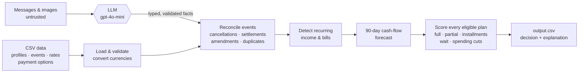

# Buy or Wait? — an AI agent that decides whether a purchase is safe

Given a person's bank history, their payment preferences and the messages they
receive ("your salary drops to EUR 1,422 next month", "the lease renewal raises
rent by 12%"), the agent answers one question for every purchase request:

> **Can I afford this — and if so, how should I pay?**

For each request it says whether the purchase is **affordable now**, **affordable
with a plan** (installments, a partial payment, or cutting a flexible expense),
**affordable later** (and on which date), or **not affordable**. It explains why
in one plain sentence:

```text
request_31  affordable_later      wait
  "Pay IDR 18,164,000 in full on 15 November 2024. Paying earlier would take the balance below the IDR 16,588,900 minimum."

request_46  affordable_with_plan  installments
  "Use 2 installments of INR 25,714, starting 3 December 2024. This leaves at least INR 135,107.05 available over the next 90 days."

request_56  affordable_with_plan  partial_payment
  "Pay USD 667.49 today and the remaining USD 214.07 on 15 February 2025. This completes the full request and keeps the USD 2,100 minimum protected."
```

(These rows are real output from the final run.)

Built for the HackerRank Orchestrate "Buy or Wait?" challenge (September 2026).
The full specification is in [problem_statement.md](problem_statement.md).

## How it decides



1. **Load.** It reads nine CSVs, validates every reference and converts
   foreign-currency events using the exact dated exchange rate.
2. **Reconcile.** Each transaction's lifecycle is resolved, including
   cancellations, settlements, amendments, reversed charges and duplicates.
   Unrealized investment gains and pending credits never count as cash.
3. **Find what repeats** ([`finance/recurrence.py`](code/finance/recurrence.py)).
   Rent on the 2nd, groceries every 7 or 10 days and salary on the 15th are
   detected from history and projected forward:
   - A series must have a regular rhythm and must not have missed its latest
     occurrence. A cancelled subscription or a stopped second income is not
     projected.
   - Bills are reserved at the mean of their last three amounts, rounded up.
   - Gig payouts whose amount swings are *not* treated as dependable salary.
     A payroll marked "final" ends the income.
4. **Read the messages (the AI part).** An LLM turns each message into typed
   adjustments such as `salary_amount`, `salary_date`, `income_ended`,
   `confirmed_income`, `expense_amount` and `new_recurring_expense`. It reads
   English and Indonesian.
   - It does **not** decide affordability. It only restates facts, which plain
     code then validates and applies
     ([`extraction/message_interpreter.py`](code/extraction/message_interpreter.py),
     [`finance/adjustments.py`](code/finance/adjustments.py)).
   - Messages tied to one transaction, and receipt images, go through a
     separate per-event extractor.
5. **Forecast 90 days.** It builds a day-by-day balance and checks that it
   never falls below the user's chosen minimum.
6. **Choose a plan** ([`decision/challenge_decision.py`](code/decision/challenge_decision.py)).
   Every plan the user accepts is checked against the forecast:
   - pay in full today
   - pay part today and the rest later
   - each seller installment option
   - wait for a later date
   - stop or reduce up to three flexible expenses

   Safe plans are then ranked by the challenge rules: finish by the deadline,
   then need no spending cuts, then lowest total cost, then start earliest,
   then use the fewest payments.

### Treating messages as untrusted

Messages and images come from outside the system, and some try to steer the
agent. The pipeline is built so they can't:

- **Separate trusted context.** The request date, home currency and known
  categories travel in their own system message. They are never read back from
  model output.
- **Strict output.** The model must answer with a strict JSON schema, and
  anything malformed is dropped. Unknown categories, amounts in another
  currency and items missing a required date are also dropped.
- **No look-ahead.** A message dated after the request is never used.
- **Unconfirmed money doesn't count.** Pending bonuses, unapproved commissions,
  refunds still processing and prize claims are ignored.
- **Cached and repeatable.** Results are cached by message text, model and
  prompt version, so a re-run makes no new calls and gives the same answers.

## Results

The challenge publishes 25 sample requests with reference answers, and
`python code/main.py --evaluate-samples` scores the agent against them. The
250 evaluation requests are scored only by the organisers, against hidden
answers.

| Field (25 public samples) | Start of this iteration | + recurrence detection | + LLM message reading |
|---|---|---|---|
| `affordability_status` | 48% | 80% | **88%** |
| `recommended_payment_method` | 56% | 88% | **96%** |
| `earliest_date_for_full_payment` | 22% | 67% | **72%** |
| `amount_safe_to_pay` (exact to the cent) | 16% | 16% | 16% |

Across the 250 evaluation requests, the final run recommends:

| Recommendation | Requests |
|---|---|
| Pay in full now | 69 |
| Wait for a safe date | 57 |
| Installments | 55 |
| Partial payment now and the rest later | 8 |
| Don't proceed | 61 |

The submission before this iteration had 103 "not affordable" verdicts and
only 8 "wait" verdicts. It ignored future salary, so later affordability was
almost never detected.

The exact safe amount is the hardest field. The reference generator's internal
forecasting assumptions are not published. The agent's amounts are usually
close, but rarely identical to the cent. The full-dataset AI run used **209 `gpt-4o-mini` calls, about 501K tokens and
about $0.08** in total, roughly 2K tokens and $0.0003 per request. Details are
in [`code/evaluation/usage_report.md`](code/evaluation/usage_report.md). A
plain-language walkthrough of how the agent was built is in
[agent_summary.md](agent_summary.md).

## Run it

Requires Python 3.8+.

```bash
python -m venv .venv
source .venv/bin/activate          # Windows: .venv\Scripts\Activate.ps1
pip install -r requirements.txt
```

Place the challenge data in `dataset/`. It is not redistributed in this repo;
see [problem_statement.md](problem_statement.md) for the layout. Then:

```bash
python code/main.py                       # rules only: free, offline, deterministic
python code/main.py --evaluate-samples    # score against the 25 public answers
```

To turn on the LLM step, set `OPENAI_API_KEY` in your environment, then:

```bash
python code/main.py --use-ai-extraction
python code/main.py --evaluate-samples --use-ai-extraction
```

`OPENAI_MODEL` overrides the default `gpt-4o-mini`. Interpretations are cached
in `.cache/`, so later runs are free.

Tests and lint run fully offline, with every model call mocked:

```bash
python -m pytest -q
python -m ruff check .
```

## Project layout

```text
code/
  main.py                     CLI entry point
  challenge_pipeline.py       load → (AI) → reconcile → forecast → decide → write; sample scoring
  loaders/                    CSV schemas, validation, currency conversion, per-request contexts
  extraction/
    message_interpreter.py    LLM: user-level messages → typed cash-flow adjustments
    event_extractor.py        LLM: event-linked messages/receipt images → event facts
    event_reconciliation.py   deterministic lifecycle resolution (cancel/settle/amend/delay)
  finance/
    recurrence.py             recurring income/expense detection and projection
    adjustments.py            applies message adjustments to the projections
    challenge_forecast.py     90-day timeline, safe amount, earliest safe date, spending cuts
  decision/challenge_decision.py   plan generation, ranking, explanations
  output/challenge_writer.py  exact-schema output.csv
  evaluation/                 metrics, sample scoring, usage report
tests/                        offline unit + integration tests (models mocked)
docs/technical-reference.md   CLI options, data formats, safety and failure behaviour
```

`--mode legacy` runs an earlier, synthetic-format prototype that is kept for
reference; see the technical reference.

## Limitations

- Spending that repeats less often than every 10 days (other than monthly) is
  not projected. In this data those habits were too irregular to reserve
  reliably.
- Spending cuts are searched only to make a full payment possible today.
  Combinations with installments or partial payments are not explored. On
  this dataset the forecast usually finds a cheaper safe plan without cuts, so
  no evaluation row recommends one. The reference answers use cuts in 3 of the
  25 samples.
- Amounts in messages are applied only when they are in the user's home
  currency. No dated exchange rate exists for them, so they are never
  converted by guesswork.
- The 25 public samples are a small benchmark. The rules were chosen to be
  defensible from the specification, not tuned until every sample matched.

## License

MIT. See [LICENSE](LICENSE).
